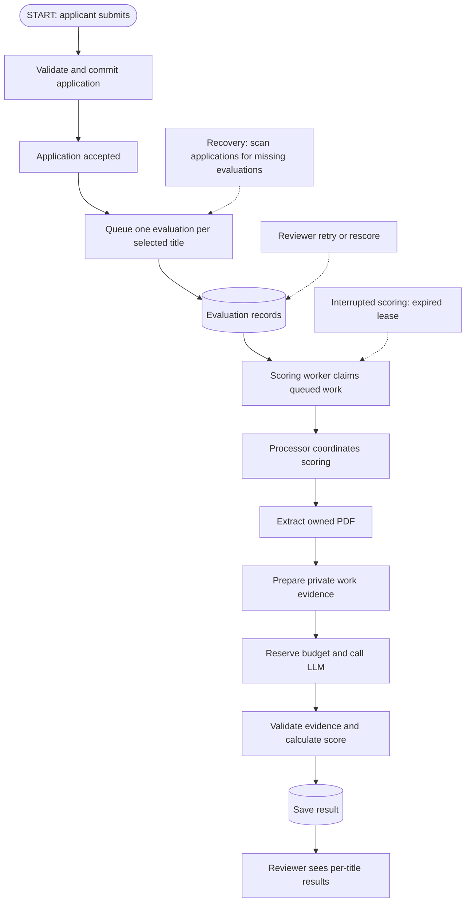

# ATS architecture

Unification contract: `AutomatedEvaluation` is the authoritative assessment for
one application, subteam and raw selected title. `ResumeScore` and normalization
modules are retained as legacy compatibility, not a second active scoring path.
Application snapshots (`resumeKey`, PDF-byte `resumeHash`, `profileSnapshot`) are
preserved. Automatic scoring rejects legacy applications without snapshots;
reviewers can still inspect their canonical working résumé manually. Extracted
text hashes are distinct from PDF-byte hashes. No cross-application result cache
is used by the active pipeline.

Each evaluation belongs to one application, subteam, and selected job title. Automated scores never write human stars, notes, or application stages.

New applications automatically queue evaluations for all selected titles after the submission transaction commits, when production scoring is enabled. Submission waits only for queue metadata writes; résumé extraction and LLM requests run later in the worker. Queue failures never reject an accepted application. If that handoff is interrupted, reconciliation subsequently creates missing evaluations. Applicants never need to resubmit because scoring failed.

## Three recovery responsibilities

- Submission queueing: immediate best-effort insert after the application transaction commits. Each title is independent.
- `EvaluationReconciliationWorker`: scans 50 applications per batch, once every 60 seconds after the previous batch completes, starting immediately at enabled startup. It reads only application metadata and existing evaluation IDs. Missing records are inserted through the same `queueSubmittedApplication` helper. Existing records in any status are skipped.
- `ATSEvaluationWorker`: processes existing queued records, recovers expired processing leases and enforces the attempt cap. Ordinary failed evaluations still require reviewer retry; reconciliation does not reset them.

The reconciler uses `_id` keyset pagination and wraps at the end of the collection, so earlier failures are retried on a later full cycle. A restart begins scanning from the start without losing work. Concurrent instances can race safely because insert-only upserts use the existing unique `(applicationId, subteamPk, jobTitle)` index. Timestamps are explicitly set only on insert, preventing duplicate delivery from modifying an existing evaluation. No new collection or schema field is needed.

Recovery time depends on collection size: one failed title may wait a full scan cycle, not just one minute. While the feature is disabled or the database unavailable, reconciliation pauses/fails safely and resumes when available. Enabling the feature reconciles historical applications too. Deploy the documented unique index before enabling multiple instances. Application acceptance does not depend on either worker.

## Start here

Read this guide, then `ATSApplicantService.applyToTeam`, `SubmissionEvaluationQueue.queueSubmittedApplication`, `ATSEvaluationWorker.tick`, `ATSEvaluationProcessor.process`, and `ATSEvaluationEngine.scoreExtractedResume`, in that order. `ATSEvaluationService.queue` handles manual recovery/rescoring. For the actual external request, follow the provider's `score` method to `responsesTransport`. For the recruiter screen, read `ExperimentalEvaluation.tsx` and its `useEvaluation.ts` hook.

| Term | Meaning |
| --- | --- |
| Applicant | A person's shared recruitment profile, including their current résumé |
| Application | That person's submission to a particular team; contains selected roles and human feedback |
| Team / subteam | Parent recruiting group / a group within it that advertises roles |
| `Pk` | Primary key: the identifier used for a team or subteam, not a résumé or application ID |
| Evaluation | One automated assessment identified by application ID, subteam key and selected job title |
| Hash | A fingerprint of normalized extracted text used to detect résumé changes |
| Lease | Temporary ownership of a processing record; a token and expiry prevent an old worker saving late results |
| Stale | A previous score whose résumé or scoring context can no longer be verified as current |

For example, synthetic applicant A submits application B to team T, selecting Frontend Engineer in subteam F and Backend Engineer in subteam K. Bulk scoring queues two independent evaluation records. Each uses A's résumé but its own title and requirements, so scores can differ. Another application by A has separate evaluations. These are illustrative identifiers, not real records.

## API walkthrough

All paths below start with `/api/ats/applications/{teamId}/{applicationId}` and require the existing `corp:hiringaccess` authorization. They are examples for reading the code; no live requests are needed for local verification.

| Operation | Method and suffix | Input |
| --- | --- | --- |
| Load one title | GET `/evaluation?subteamPk=F&jobTitle=Frontend%20Engineer` | Query parameters |
| Queue one title | POST `/evaluation` | `{"subteamPk":"F","jobTitle":"Frontend Engineer"}` |
| Retry failed title | POST `/evaluation/retry` | Same JSON body |
| Queue every selected title | POST `/evaluation/all` | No body |

Single-title responses include `configured`, `label` and `evaluation`; no record is represented by `evaluation: null`. Bulk responses contain per-title results, allowing one title to fail independently. Missing production configuration blocks queueing with a safe 503 response.

| Current state | Event | Result |
| --- | --- | --- |
| No record / stale | Queue valid title | queued |
| queued | Worker atomically claims | processing; attempt count increases |
| processing | Validated score saved with valid lease | scored |
| processing | Extraction/provider/validation fails | failed; explicit retry required |
| processing, expired lease | Worker recovery below attempt cap | processing with a new token |
| queued or expired processing at attempt cap | Worker exhaustion | failed |
| failed below cap | Explicit retry | queued; attempt count preserved |
| scored | Résumé/context changes or cannot be verified | stale on read, or requeued on a scoring request |

Ordinary failures do not automatically retry. Only interrupted work with an expired lease is automatically recovered. The UI polls queued/processing states and stops for scored/failed/stale.

## Local verification

From `peopleportal/server`, using already installed dependencies:

```sh
./node_modules/.bin/tsoa spec-and-routes
./node_modules/.bin/tsc
NODE_ENV=test node --require ./test/helpers/ats-network-guard.js --require ./test/helpers/bootstrap.js --test test/unit/ats-evaluation.test.js test/unit/ats-runtime.test.js test/unit/ats-boundaries.test.js test/unit/ats-submission-scoring.test.js test/unit/ats-reconciliation.test.js
```

Tests inject mocked model methods, PDF parsing/object reading and provider transport. The network guard rejects accidental external connections. No real résumé or shared service is needed.

## Privacy examples

The privacy rules intentionally prefer dropping uncertain information. They are conservative heuristics, not a guarantee of semantic privacy detection.

| Synthetic input | Treatment |
| --- | --- |
| `Built a React application with TypeScript and measured faster rendering.` | Retained as work evidence, subject to the overall minimum text length |
| `Jane Example`, `Education: Prestigious University` | Dropped as identity/education headers |
| `Built a React application for Acme Corporation` | Organization phrase replaced before provider input |
| Provider explanation containing an email, phone, address, protected trait or prestige claim | Rejected before saving |
| Provider evidence that does not appear exactly in the sanitized text | Rejected before saving |

Contact replacement, work-line selection, organization redaction and the approved capitalized vocabulary are named separately in `ResumePreparation.ts`. Changes to these rules require input/output boundary tests.



## File map

| File | Responsibility |
| --- | --- |
| ATSEvaluationService.ts | HTTP-facing context validation, read, queue, retry, bulk queue, stale checks, public projection |
| SubmissionEvaluationQueue.ts | Post-commit automatic queueing for every applied title; insert-only, gated, independent failures |
| EvaluationReconciliationWorker.ts | Bounded metadata scan that repairs missing evaluations without touching existing records |
| ATSEvaluationProcessor.ts | Extract and score one record; save only while the worker owns its lease |
| ATSEvaluationWorker.ts | Atomic claim, expired-lease recovery, retry exhaustion, bounded scheduling |
| ATSEvaluationTypes.ts | Shared dependency types, category/status keys, limits and configuration error |
| ATSEvaluationEngine.ts | Provider contract, sanitized input boundary, rubric/prompt versions, hash, output validation, weighting |
| ResumePreparation.ts | Readable-text validation, privacy preparation, prohibited-content checks and safe evaluation errors |
| ResumeExtractor.ts | Owned PDF validation, bounded reading, Poppler extraction, known-name redaction |
| OpenAIScoringProvider.ts | Request/schema construction, conservative cost estimate, transport, response parsing |
| ATSEvaluationSetup.ts | Configuration validation, production dependency wiring and worker startup |
| ATSApplicantService.ts | Applicant profiles, uploads, application submissions |
| ATSApplicationService.ts | Human review, feedback, stages and hiring workflows |
| ATSRecruitmentService.ts | Roles, requirements, recruitment configuration and invalidation |
| ATSHelpers.ts | Shared HTTP contracts and existing recruitment helpers |

Outside this directory, `AutomatedEvaluation` stores scores and leases, `ScoringBudget` atomically reserves spend, and `ATSController` enforces hiring authorization. Generated `routes.ts` is rebuilt with tsoa.

The web dashboard mounts `ExperimentalEvaluation.tsx`. Its `useEvaluation.ts` hook loads one title, polls every three seconds while queued/processing, and stops at a terminal status. `useEvaluation.ts` contains the request helper, endpoint and presentation constants. Bulk queue refreshes every panel.

## Lifecycle and boundaries

Queue operations validate the application and selected role before creating or reusing its record. A worker atomically claims queued work or expired processing work, increments attempts, and assigns a token with a two-minute expiry. Writes require that token and an unexpired lease. After three attempts, recoverable queued/expired work becomes failed. Explicit retry remains restricted to failed records under the cap.

Before returning or reusing scored results, the service verifies current résumé content and context. Hash, title, requirements, rubric, prompt, or model changes invalidate reuse. Archived/unverifiable scores become stale. Unchanged content and versions avoid another provider call. Requirement changes also invalidate queued/processing work through recruitment configuration updates.

Extraction accepts only the applicant's canonical owned PDF key. Bytes and text remain in memory. Privacy preparation runs once through `prepareScoringInput`, producing a branded `SanitizedScoringInput` accepted by providers. This TypeScript boundary is not a runtime security boundary for JavaScript callers: all production callers must enter through the engine. Regex/name filtering is conservative and requires continued review. Provider output is checked for prohibited information, category validity, exact evidence excerpts and length limits before persistence. Safe errors never carry source text or provider errors.

Production wiring requires production mode, explicit club confirmation, S3 bucket configuration, scoring enabled, club API key, model, token cap, per-evaluation cap, total budget and input/output pricing. Normal development and tests construct no live dependencies. Budget reservations are pessimistic and never refunded on ambiguous failures. See `../../../ATS_EVALUATION_ROLLOUT.md` for deployment prerequisites, including Mongo indexes/ledger and Poppler. No migration or deployment is performed by this refactor.

## Extension points

- Provider: implement `ScoringProvider` and accept only `SanitizedScoringInput`; select it through server runtime wiring. Inject mocked transport in tests.
- Rubric/prompt: update weights/instructions and increment the respective version in the engine; verify stale handling.
- Category: update `CATEGORY_KEYS`, weights, structured schema constraints, UI labels and validation fixtures together.
- Status: update `EVALUATION_STATUSES`, model transitions, queue queries, public UI types and polling behavior together.
- Tests: unit files use mocked Mongo methods, synthetic text, injected parser/object readers and provider transports. Load `test/helpers/ats-network-guard.js` to reject accidental external connections.
