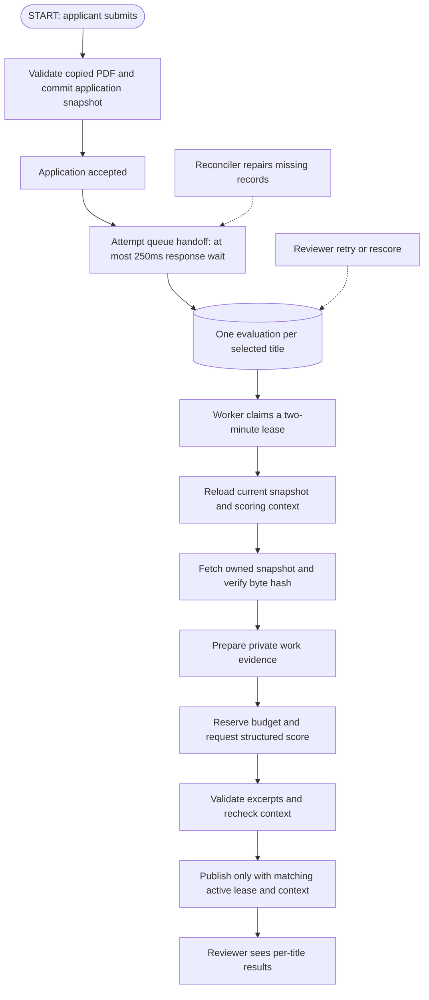

# ATS: start here

The active system evaluates each **application + subteam + raw selected title** independently.
Human stars, notes and hiring decisions remain separate. All live scoring stays disabled
until complete club configuration and version-matched privacy approval are provided.



## Reading order and file map

Read the first six rows in order to trace one evaluation, then the privacy/provider and UI code.

| File | Purpose |
| --- | --- |
| ATSApplicantService.ts | Validates submission, copies/hashes its PDF, saves profile/application/link transactionally, attempts queue handoff |
| SubmissionEvaluationQueue.ts | Shared insert-only creation; failed titles remain recoverable |
| EvaluationReconciliationWorker.ts | Finite metadata sweep, 50 applications/batch, 60-second delay between completed batches |
| ATSEvaluationWorker.ts | Atomic claims, bounded attempts, expired-lease recovery and draining stop |
| ATSEvaluationProcessor.ts | Reloads context, runs extraction/scoring, verifies context again and fences every write |
| ATSEvaluationEngine.ts | Context fingerprint, provider contract, instructions, validated weighted score |
| ResumeExtractor.ts | Bounded Poppler extraction, exact application-owned key and snapshot-byte verification |
| ResumePreparation.ts | Text checks, wrapped-bullet reconstruction, instruction/trait screening and reviewed vocabulary |
| OpenAIScoringProvider.ts | Structured schema, request/response helpers and pessimistic spend reservation |
| ATSEvaluationService.ts | Authorized API operations, freshness checks and atomic retry/rescore transitions |
| ATSEvaluationTypes.ts | Shared limits, dependency types, narrative choices and fixed operational events |
| ATSEvaluationSetup.ts | Full production configuration gate and dependency/worker setup |
| ATSApplicationService.ts | Manual reviewer feedback/stages and submitted-profile reads |
| ATSRecruitmentService.ts | Recruiting settings and best-effort score invalidation |
| ATSHelpers.ts | Shared HTTP contracts and validation |

Outside this folder: `AutomatedEvaluation` owns results; `ScoringBudget` owns reserved spend;
`ATSController` enforces hiring authorization. The web's `ExperimentalEvaluation.tsx`
renders per-title panels; `useEvaluation.ts` handles abortable requests and polling.

## Terms and example

An applicant is a person; an application is that person's submission to one team.
A subteam advertises free-text roles. `Pk` means its identifier. One application
selecting Frontend Engineer and Backend Engineer receives two evaluation records.
Another application by the same person has its own records and may have different
requirements/results even with identical PDF bytes.

`Application.resumeKey` is the exact snapshot key
`resumes/{applicantId}/{applicationId}.pdf`; `resumeHash` is SHA-256 of PDF bytes.
`profileSnapshot` includes the submitted profile and server-selected submitted name.
The extractor verifies bytes against that hash before parsing. `resumeContentHash`
is a separate normalized extracted-text fingerprint. Neither PDF bytes nor full text
are persisted; only hashes and validated sanitized evidence excerpts are saved.

Legacy applications without snapshots are not automatically scored using a newer
working upload. Reviewers retain a canonical working-résumé fallback for manual
inspection. Snapshot creation failures reject an unaccepted submission. Scoring
failures never reject an accepted application. An ambiguous commit never triggers
snapshot deletion; orphan cleanup requires separate operator approval.

## One authoritative result contract

The context fingerprint includes snapshot byte hash, exact raw title, trimmed
requirements, rubric version, prompt version and model version. Reads compare
current metadata rather than downloading/extracting each PDF repeatedly. This
assumes snapshot objects are immutable; processing independently verifies bytes.
Deployment must prohibit overwriting/deleting referenced snapshot keys except an
explicit audited migration. A bucket administrator bypassing that contract can make
a metadata-only freshness read obsolete; this must be tested/enforced in staging.
Changing model/preparation/rubric requires a corresponding version change.

The teammate's `ResumeScore`, scorer interface, normalization helpers, documents
and commit history are retained as legacy compatibility. They are not a second
automatic scoring path, their cache is not reused by AutomatedEvaluation, and stub
zero scores are never shown as real assessments. Application details return no
legacy scores; the reviewer panels read the evaluation API.
Other API clients must migrate from the deprecated details `scores` array (now
empty) to the evaluation endpoints. This intentional compatibility change must be
included in release notes before consumers are upgraded.

## State and recovery

| State/event | Outcome |
| --- | --- |
| Successful submission | Immediate best-effort metadata queueing, bounded response wait |
| Missing record | Reconciler inserts only that application/title combination |
| Existing record in any state | Reconciler leaves it untouched |
| Queued/expired processing below cap | Worker claims token, increments attempt/revision |
| Valid result, unchanged context, valid lease | Scored |
| Requirements changed during request | Stale; obsolete result is not published |
| Extraction/provider/validation failure | Failed with a safe code/message |
| Same-context failed retry at three attempts | Blocked |
| New scoring context | Fresh bounded attempt cycle |

Manual transitions use expected status/revision; completion requires processing
status, token, unexpired lease and context. Current context is loaded before and
after scoring, catching configuration invalidation that was interrupted. GET also
checks current context before presenting a score as current. Mongo unique-index
behavior still needs approved staging verification.

Reconciliation captures an upper application ID per sweep so new arrivals cannot
starve earlier failures. It batches existing-evaluation reads and memoizes subteam
configuration per batch. Startup restarts the scan safely. Recovery can take a full
sweep, not one minute. All historical applications are inspected, including legacy
ones that must fail safe/manual review. One scoring worker processes one job at a
time, waiting two seconds between completions. This is not a measured 1,000-job SLA.

Shutdown stops new HTTP requests and schedules, drains active jobs, closes resources,
and forces termination after 30 seconds if needed. Interrupted leases recover later.
Fixed `[ats]` event codes expose failures without source data; production metrics
aggregation/backlog alerting is an operator prerequisite.

## Privacy, evidence and costs

Wrapped bullets are reconstructed before selection. Instruction/protected-content
bullets are removed, known submitted names redacted, and unknown Unicode words
replaced using a reviewed work vocabulary. This can discard useful unfamiliar
technical content and cannot guarantee semantic privacy across all formats.
Fixed narrative output choices prevent free-form identifying explanations.
Job titles and optional requirements cross the same vocabulary boundary before
provider use; their original values still define the application/context identity.
Positive scores require substantive exact excerpts; placeholder-only evidence is rejected.
Weights: skills 35%, projects 35%, transferable experience 20%, outcomes 10%.

Production requires `NODE_ENV=production`, `ATS_AI_CLUB_CONFIRMED=true`,
`ATS_AI_PRIVACY_REVIEWED_VERSION=work-evidence-v4`, S3 bucket configuration, and all
static AWS credentials required by the existing S3 client, together with
provider model/token/per-evaluation/total-budget/pricing settings. Club owners must
review privacy, evidence quality and fairness before providing approval. Pin a model
snapshot and review prices. The gate is not itself proof of privacy or fairness.
Budget reservations are conservative and not refunded on ambiguous failures;
reserved spend can exceed actual billing. Missing ledger records fail closed.

## API and local verification

All evaluation routes require `corp:hiringaccess`. Prefix:
`/api/ats/applications/{teamId}/{applicationId}`.

- GET `/evaluation?subteamPk=sub&jobTitle=Frontend%20Engineer`
- POST `/evaluation` or `/evaluation/retry` with
  `{"subteamPk":"sub","jobTitle":"Frontend Engineer"}`
- POST `/evaluation/all` for selected titles only.

From `peopleportal/server`, with installed dependencies:

```sh
./node_modules/.bin/tsoa spec-and-routes
./node_modules/.bin/tsc
NODE_ENV=test node --require ./test/helpers/ats-network-guard.js --require ./test/helpers/bootstrap.js --test test/unit/ats-*.test.js
```

Tests use synthetic data, query-aware model doubles and injected parser/provider
responses. They are not proof of real Mongo concurrency, S3 ownership policy,
Poppler deployment or OpenAI compatibility. Do not hand-edit generated routes.
See `../../../docs/ats-change-ledger.md` for commits/reviews/rollback order and
`../../../ATS_EVALUATION_ROLLOUT.md` for deployment prerequisites. Provider, category
or status extensions must update types, schema, versions, UI and boundary tests
together; never reuse old cached results under a new scoring context.
